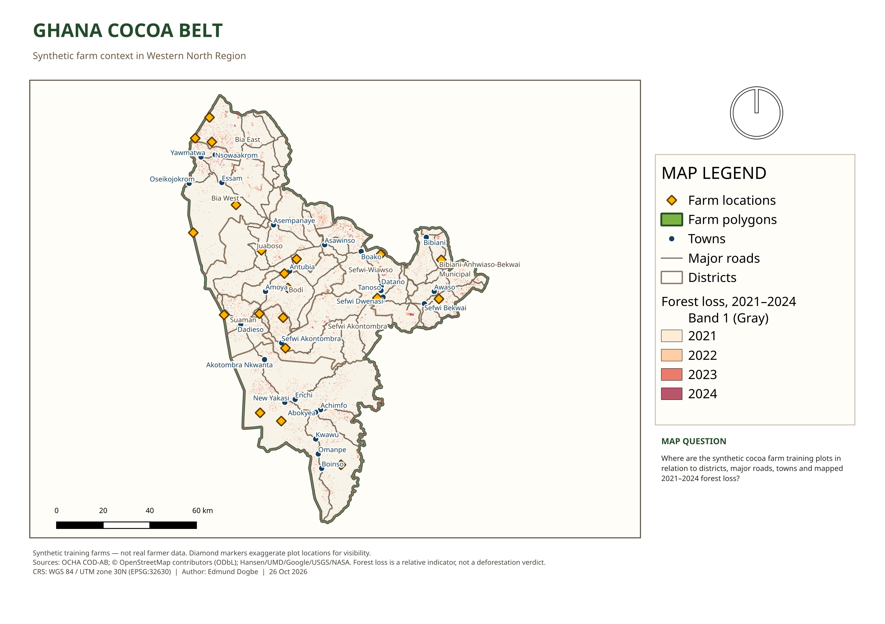

# Ghana Cocoa Belt — Phase 1 QGIS project

This is the finished proof-of-work project for Phase 1 of the geospatial software engineer roadmap. It uses only open contextual data and **synthetic farm polygons**—no real farmer locations or personal data.



## Map question

Where are the synthetic cocoa farm training plots in relation to districts, major roads, towns and mapped 2021–2024 forest loss in Ghana's Western North Region?

## Open the project

- QGIS project: `ghana-cocoa-belt.qgz`
- Print outputs: `exports/ghana-cocoa-belt.pdf` and `exports/ghana-cocoa-belt.png`
- Source manifest and processing log: `SOURCES.md`
- CRS decisions and measurement experiment: `../notes/01-crs-cheatsheet.md`

The project uses relative paths. Downloaded and processed datasets are intentionally excluded from Git by `.gitignore`; follow `SOURCES.md` to restore them on another machine.

## Workflow

1. Selected Western North from Ghana ADM1 boundaries and its nine ADM2 districts.
2. Clipped Geofabrik roads and places to the study region.
3. Reprojected analysis layers from WGS 84 to **WGS 84 / UTM zone 30N (EPSG:32630)**.
4. Created 20 fictional cocoa farm polygons, calculated hectares from projected geometry and joined each farm to its containing district.
5. Clipped Hansen Global Forest Change v1.12 loss-year data to the study region and displayed 2021–2024 as categorical values.
6. Styled the map, added credits and limitations, and exported an A4 landscape layout.

The diamond farm markers are deliberately larger than the actual plots so the 0.80–6.30 ha polygons remain visible on a region-scale map. The polygon layer remains in the project for inspection and closer-scale work.

## Quality checks

| Check | Result |
| --- | ---: |
| Synthetic farm polygons | 20 |
| Invalid farm geometries | 0 |
| Overlapping farm pairs | 0 |
| Farms outside Western North | 0 |
| Farms with missing area | 0 |
| Farms joined to a district | 20 |
| Distinct joined districts | 9 |
| Area range | 0.80–6.30 ha |

The final project archive passed ZIP integrity checks, all map sources are stored as relative paths, and the PDF is a one-page A4 export. The reusable export script is `scripts/finalize_qgis_project.py`; after restoring the data products, run:

```bash
QT_QPA_PLATFORM=offscreen python3 phase-1/scripts/finalize_qgis_project.py
```

## Interpretation and limitations

- These farm boundaries and survey dates are synthetic training data and must not be used operationally.
- OSM coverage and tagging vary by contributor activity; the map shows only major-road classes and named towns for readability.
- Administrative boundaries are contextual and should not be treated as cadastral or survey boundaries.
- Hansen tree-cover loss is a relative stand-replacement indicator. It is **not** a deforestation verdict, a legal assessment or a substitute for higher-resolution review.
- The source raster covers loss through 2024, so this map does not describe later change.

## Repository decision

Keep this project in the current roadmap repository. It is the Phase 1 evidence that supports later phases, while its large downloaded data stays untracked. A separate repository becomes useful in Phase 2 for the reusable `plotcheck` Python package, with its own dependencies, tests, releases and CI.
